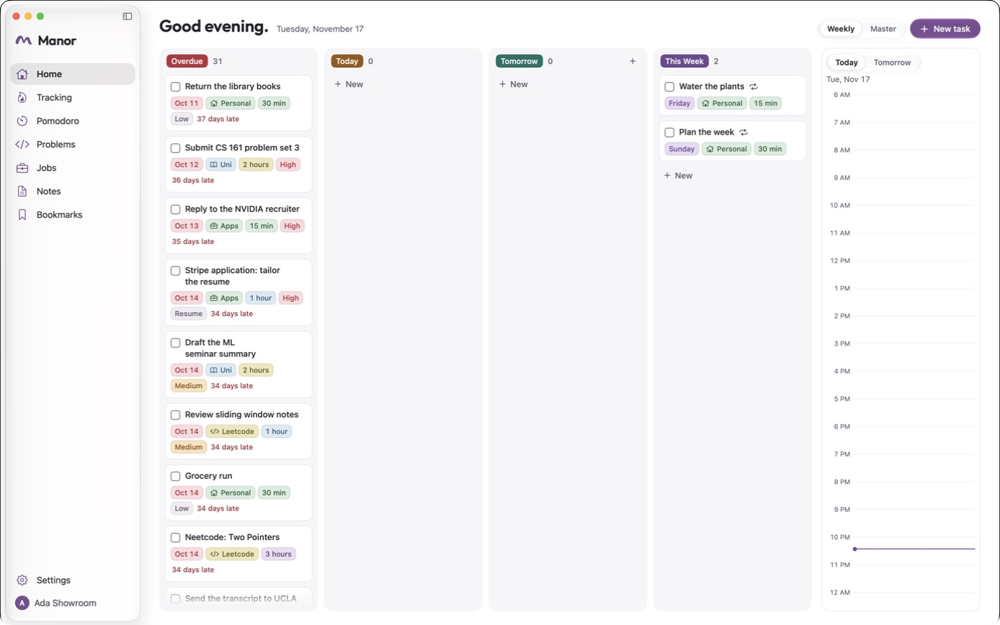
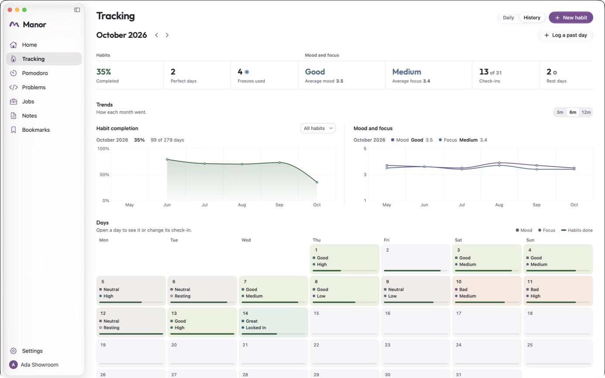
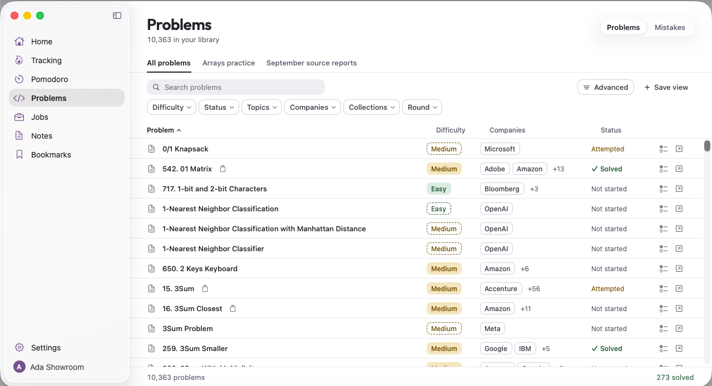
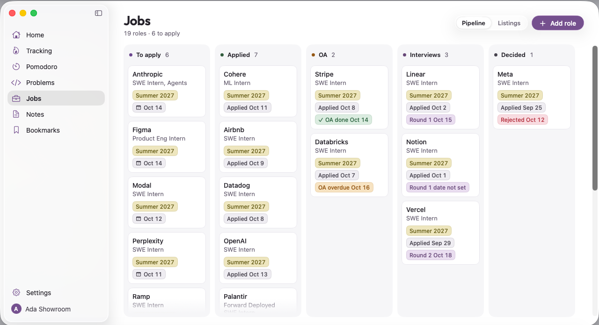
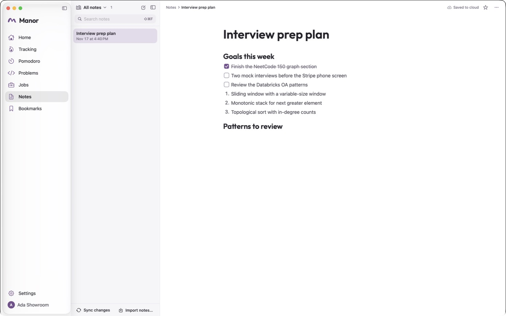
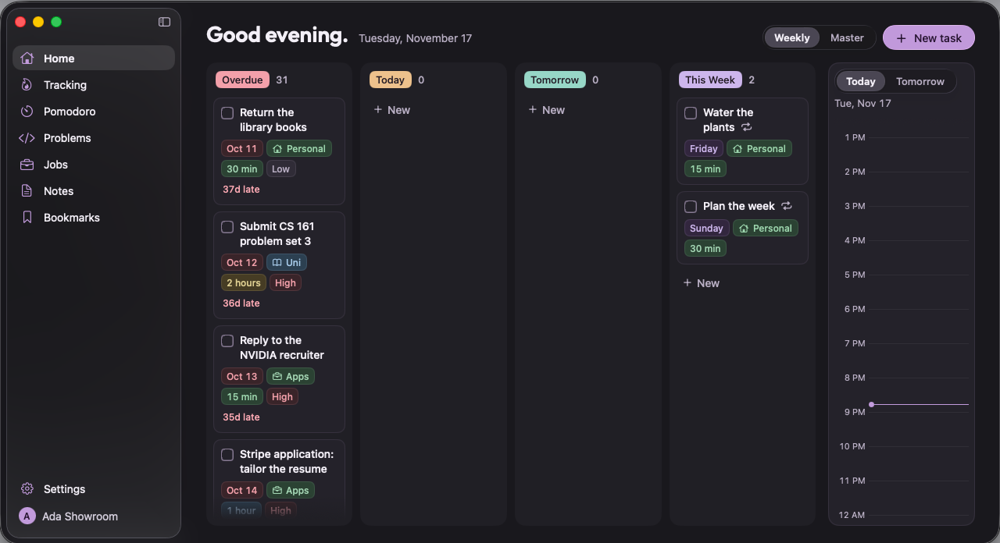

<p align="center">
  
</p>

<h1 align="center">Manor</h1>

<p align="center">
  A native Mac app for tasks, habits, mood, focus timers, coding interview practice, job applications, and notes,<br>
  with a personal assistant in the notch. Use it directly, or let an AI agent work in it over MCP.
</p>

<p align="center">
  
  
  
</p>

Manor brings your tasks, habits, notes, and other records together in one place that is easy to keep current. Every change, whether it comes from the app or from an agent, goes through the same command boundary: idempotent, revision-checked, receipted, and recorded in a durable action history. Pages read from a copy of your account kept on your Mac, so they open instantly and stay readable offline.

## Contents

- [Key features](#key-features)
- [Screenshots](#screenshots)
- [How it works](#how-it-works)
- [Working with an agent](#working-with-an-agent)
- [Installing](#installing)
- [Building from source](#building-from-source)
- [Repository layout](#repository-layout)
- [Documentation](#documentation)
- [Status](#status)
- [Credits](#credits)
- [License](#license)

## Key features

- **Home.** A due-bucket task board (Overdue, Today, Tomorrow, This Week) and a Master table grouped by context, beside a timeline of your Google Calendar events and disposable time blocks. Recurring tasks track each occurrence independently.
- **Tracking.** Habits, mood, and focus on one page: daily check-offs with per-habit streaks, a shared monthly freeze pool spent by hand, Earn-Back recovery, one-tap mood and focus ratings, and a History tab with trends, completion rings, and a month calendar.
- **Pomodoro.** A focus timer with short and long breaks, a live countdown in the sidebar, editable lengths and cycle, optional auto-start, and month statistics with a session log.
- **Problems.** A shared library of about 10,000 coding interview problems: every LeetCode problem plus company-reported interview questions, each with an original statement, hints, and a written solution ending in Python. About 8,600 run against hidden tests in C++, Python, Java, Go, and JavaScript, in a native editor with completion and diagnostics from real language servers. Topic categories, company and round filters, saved views, automatic attempt logging, and a mistakes log.
- **Jobs.** A Pipeline board from To apply through Offer with a flow chart of every application, and a Listings view of the SimplifyJobs internship catalog.
- **Notes.** A block editor with columns, tabs, tables, media, equations, and a live table of contents. Drafts are protected on your Mac before they sync, concurrent edits merge by block, and seven days of versions can be restored.
- **Bookmarks.** X bookmarks and agent-supplied captures with text and semantic search.
- **Alfred.** A personal assistant in the notch and the menu bar. General mode answers questions about your screen; Prep mode listens to a call and prepares answers, with live diagrams and charts. Inside Manor, the same shortcut opens Alfred in the window, where it answers about the page you're on and makes changes you ask for, each with Undo. In Notes, `/alfred` writes diagrams, tables, and prose as real blocks, and Command-J rewrites a selection through a preview. It uses your own OpenAI and Deepgram keys and keeps its data on your Mac.
- **Weekly reviews.** A scheduled review of habits, mood, focus, and tasks, written by a hosted ChatGPT task and saved back into Manor.

Light and dark modes are both first-class, and Liquid Glass draws the floating chrome on macOS 26.

## Screenshots

These are captured from the staging build with the synthetic showroom account.

<p align="center">
  
</p>

<p align="center">
  
  
</p>

<p align="center">
  
  
</p>

<p align="center">
  
</p>

## How it works

1. The app is Swift: SwiftUI and AppKit for the interface, and a core library for domain rules, the network gateway, and a SQLite copy of your account.
2. A [sync engine](docs/arch-components/local-mirror-and-sync.md) fills that copy once and keeps it current from the database's change feed, so pages read from disk in milliseconds. Writes, files, and note history still go to Supabase.
3. Every mutation is a named command executed in a Postgres transaction. Commands carry an idempotency key and an expected revision, return a receipt with the committed record, and write field-level events to an account-scoped history.
4. Agents reach the same commands through a remote MCP endpoint secured by OAuth 2.1 with per-client read or read and write scope. There is no separate agent database access.
5. Problems are a shared catalog delivered to your Mac as a verified compressed snapshot plus a change feed, while attempts, drafts, and submissions stay private. Code runs in isolated Blaxel sandboxes; hidden tests and expected answers never reach the app.
6. Background workers own the outside world: Google Calendar syncs every minute, X bookmarks and the jobs catalog refresh on schedules, an embedding worker indexes notes and captures, and a maintenance job materializes recurrences, reconciles streaks, and purges Trash after seven days.
7. Notes and code edits are written to a local database before any network call, saved in order per document, and merged against the server revision, so a dropped connection or a quit never loses typing.

## Working with an agent

Manor exposes 133 operations (52 reads, 81 writes) at `https://<project-ref>.supabase.co/functions/v1/manor-mcp`. Connect it as an MCP server in Codex, ChatGPT, Claude, or any OAuth-capable client. Sign-in stays in the client's own window: a small consent page opens Manor, you approve there, and the client finishes connecting on its own. Then ask for work in plain language:

- "Add this posting to my applications and attach the resume I used for NVIDIA."
- "Read my inbox and create tasks for anything with a deadline this week."
- "Log today's mood as Good and focus as High."
- "Find a medium sliding-window problem Google asked recently."

Reads return record IDs and revisions; writes require them, so an agent can't accidentally touch records that started matching a filter after it looked. Bulk operations are bounded and report per-item results. What the agent can read is exactly what you can.

## Installing

Download the app from the [releases](https://github.com/rithm84/Manor/releases), unzip it into Applications, and open it. Builds are signed with Manor's own certificate rather than a Developer ID, so macOS asks you to approve the first launch. After that, Manor updates itself.

Creating an account requires an invitation password, and connecting an agent requires the hosted MCP URL. Neither is published here, so [open an issue](https://github.com/rithm84/Manor/issues) to ask for them. Each account's data is private to that account.

## Building from source

You need macOS 15 or later and a Swift 6 toolchain; the macOS 26 SDK adds Liquid Glass. From `macos/`:

```sh
swift build                                  # build the app and its libraries
swift test                                   # run the unit tests
scripts/build-app.sh staging --debug --open  # bundle, sign, and open Manor Staging
```

A bundle needs `macos/config/<environment>.env` with `SUPABASE_URL` and the publishable `SUPABASE_KEY`; git ignores these files. The [releases and updates](docs/arch-components/releases-and-updates.md) slice covers signing and publishing.

## Repository layout

```
macos/                 The native app: Swift package, scripts, resources, tests
supabase/              Migrations, Edge Functions (MCP, problem runner, files, integrations, workers), SQL tests
site/                  The OAuth consent bridge page, deployed to GitHub Pages
tools/problem-import/  Catalog import, snapshot, and duplicate-merge tooling
tools/problem-runner/  The sandbox runtime image, harnesses, and smoke tests
tools/recovery/        Encrypted backups (restic and rclone) and isolated restore
docs/                  PRD, decisions, architecture and its component slices, design charter, diagrams
```

## Documentation

| Document | Owns |
|---|---|
| [PRD](docs/PRD.md) | Product behavior, business rules, and vocabulary |
| [Product decisions](docs/DECISIONS.md) | The dated record of product decisions |
| [Architecture](docs/ARCHITECTURE.md) | The system map, with [component slices](docs/arch-components/) for detailed contracts |
| [Design charter](docs/DESIGN.md) | Visual direction, typography, color, components, and motion |
| [Agent guide](AGENTS.md) | Conventions for coding agents working in this repository |

Diagrams are Mermaid sources in `docs/diagrams/pele/`, rendered to SVG with `npm --prefix docs/diagrams run render`.

## Status

Manor runs as a native Mac app installed from its [releases](https://github.com/rithm84/Manor/releases) and updates itself from there. Remaining release items, such as the off-site file backup drill, are tracked in the [architecture status](docs/ARCHITECTURE.md#status). The problem catalog is shared, each account's data is private, and collaboration features are out of scope.

## Credits

[Supabase](https://supabase.com/) for the backend, [supabase-swift](https://github.com/supabase/supabase-swift), [GRDB](https://github.com/groue/GRDB.swift) for SQLite, [swift-markdown](https://github.com/swiftlang/swift-markdown), [SwiftMath](https://github.com/mgriebling/SwiftMath) for equations, [Blaxel](https://blaxel.ai/) for code execution sandboxes, open-source language servers for the code editor, [Deepgram](https://deepgram.com/) and [OpenAI](https://openai.com/) for Alfred, [restic](https://restic.net/) and [rclone](https://rclone.org/) for recovery, [Pele](https://pele.run/) for diagrams, and the [Outfit](https://fonts.google.com/specimen/Outfit) typeface and Latin Modern Math font under their open licenses.

## License

Copyright © 2026 Rithvik Manikandan. Manor is licensed under the [GNU Affero General Public License v3.0](LICENSE). Third-party components retain their own licenses. LeetCode and NeetCode are trademarks of their respective owners, and company names and logos identify their owners.
